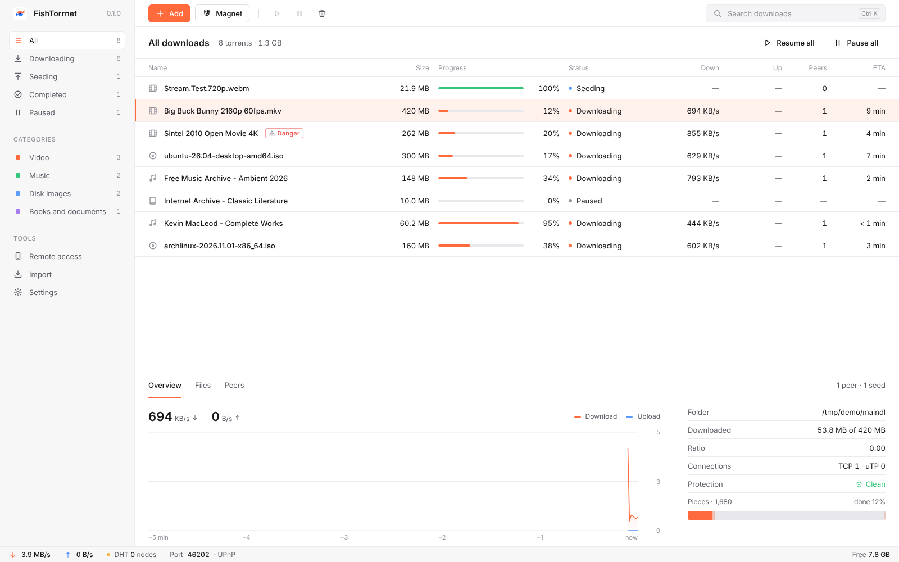

# FishTorrnet

Быстрый и честный BitTorrent-клиент. Без рекламы, без телеметрии, с открытым кодом.


## Возможности

- **Обычный BitTorrent.** Magnet-ссылки, .torrent-файлы, трекеры, DHT, PEX, uTP, UPnP и поиск пиров в локальной сети. FishTorrnet работает в той же сети, что qBittorrent, Transmission и другие клиенты.
- **Просмотр во время загрузки.** Видео и музыка открываются во встроенном плеере сразу: нужные куски скачиваются первыми. Ссылку на поток можно открыть в VLC.
- **FishGuard.** Перед загрузкой клиент проверяет список файлов. Он находит двойные расширения вроде `video.mp4.exe`, скрытые символы, которые переворачивают имя файла, программы и «кодеки» внутри раздач с фильмами, ярлыки и файлы с паролями к архивам. Опасную раздачу нельзя добавить, пока пользователь не подтвердит риск.
- **Управление с телефона.** Включите удалённый доступ в настройках и отсканируйте QR-код. Интерфейс подстраивается под маленький экран.
- **Импорт из qBittorrent и uTorrent.** Раздачи переносятся вместе с папками, скачанные файлы проверяются и продолжают раздаваться.
- **Тёмная и светлая тема** со своим логотипом для каждой, русский и английский язык.
- **Ограничение скорости** загрузки и отдачи без перезапуска.

| Светлая тема | Проверка FishGuard | Телефон |
| --- | --- | --- |
|  |  |  |

## Установка

Готовые сборки лежат на странице [Releases](https://github.com/myfreeze-art/FishTorrnet/releases).

| Система | Как установить |
| --- | --- |
| Windows | `FishTorrnet_*_x64-setup.exe` из выпуска или `winget install myfreeze-art.FishTorrnet` |
| macOS | `FishTorrnet_*_universal.dmg` из выпуска |
| Ubuntu, Debian | `.deb` из выпуска |
| Fedora, openSUSE | `.rpm` из выпуска |
| Arch Linux | `yay -S fishtorrnet-bin` |
| Любой Linux | `.AppImage` из выпуска |
| Сервер или NAS | `docker run -p 8787:8787 -v ./downloads:/downloads ghcr.io/myfreeze-art/fishtorrnet` |

Установщики не подписаны платным сертификатом, поэтому при первом запуске система предупредит один раз. В Windows нажмите «Подробнее», затем «Выполнить в любом случае». В macOS откройте «Системные настройки → Конфиденциальность и безопасность» и нажмите «Всё равно открыть». Контрольные суммы всех файлов лежат в `SHA256SUMS.txt` в каждом выпуске.

Как выпускать версии и публиковать программу в Microsoft Store, winget, AUR, Flathub и Docker, описано в [packaging/README.md](packaging/README.md).

## Сборка из исходников

Нужны Rust 1.85 или новее и Node.js 20 или новее.

На Linux дополнительно нужны системные библиотеки:

```sh
sudo apt install libwebkit2gtk-4.1-dev libgtk-3-dev libayatana-appindicator3-dev librsvg2-dev
```

Настольное приложение:

```sh
npm ci
npm ci --prefix ui
npm run app:build
```

Установщики появятся в `target/release/bundle`.

Сервер без окна, например для домашнего сервера или NAS:

```sh
npm ci --prefix ui
npm --prefix ui run build
cargo build --release -p fishtorrnet-server
./target/release/fishtorrnet-server --listen 0.0.0.0:8787 --download-dir ~/Downloads/FishTorrnet
```

Сервер напечатает ссылку с ключом доступа. Откройте её в браузере на любом устройстве в сети.

## Разработка

```sh
cargo run -p fishtorrnet-server -- --listen 127.0.0.1:8787
npm --prefix ui run dev
```

Интерфейс откроется на `http://localhost:5173`, запросы к `/api` уйдут в запущенный сервер. Ключ доступа лежит в файле `token` в папке настроек: на Linux это `~/.config/FishTorrnet`, на macOS `~/Library/Application Support/FishTorrnet`, на Windows `%APPDATA%\FishTorrnet`. Откройте `http://localhost:5173/?t=КЛЮЧ`.

Тесты:

```sh
cargo test --workspace
```

Интеграционный тест `crates/engine/tests/swarm.rs` запускает два клиента, раздаёт файл с одного на другой, проверяет потоковое чтение с середины файла и сверяет скачанные данные.

## Устройство проекта

| Папка | Что внутри |
| --- | --- |
| `crates/engine` | Ядро: сессия librqbit, настройки, FishGuard, импорт, HTTP API, потоковая отдача файлов |
| `crates/server` | Сервер без окна |
| `src-tauri` | Настольное приложение на Tauri: окно, выбор папки, magnet-ссылки и .torrent-файлы из системы |
| `ui` | Интерфейс на React и TypeScript |
| `assets` | Логотипы в SVG |
| `packaging` | Описания для Microsoft Store, winget, AUR и Flathub, файл .desktop для Linux |
| `vendor/librqbit-tracker-comms` | Копия модуля трекеров librqbit с запасным IPv4-сокетом для систем без IPv6 |

Ядро и интерфейс общаются через HTTP API на `127.0.0.1`. Каждый запрос должен содержать ключ доступа в заголовке `x-fishtorrnet-token` или в параметре `t`. Действия с файлами на компьютере, например открыть папку, доступны только из окна самого приложения.

## API

| Метод | Путь | Назначение |
| --- | --- | --- |
| GET | `/api/state` | Список раздач и состояние сессии |
| GET, PUT | `/api/settings` | Настройки |
| POST | `/api/preview` | Получить список файлов и отчёт FishGuard по magnet-ссылке или .torrent |
| POST | `/api/add` | Добавить раздачу |
| GET, DELETE | `/api/torrents/{id}` | Подробности, удаление (`?files=true` удаляет файлы) |
| POST | `/api/torrents/{id}/pause`, `/resume` | Пауза и продолжение |
| POST | `/api/torrents/{id}/files` | Выбрать файлы для загрузки |
| GET | `/api/torrents/{id}/peers`, `/pieces` | Пиры и карта кусков |
| GET | `/api/torrents/{id}/stream/{file}` | Поток файла с поддержкой Range |
| GET, POST | `/api/import` | Найти и импортировать раздачи qBittorrent или uTorrent |
| GET | `/api/remote` | Адреса и QR-код для телефона |

## Лицензия

GPL-3.0-or-later, текст в файле [LICENSE](LICENSE). Ядро BitTorrent: [librqbit](https://github.com/ikatson/rqbit), Apache-2.0.
