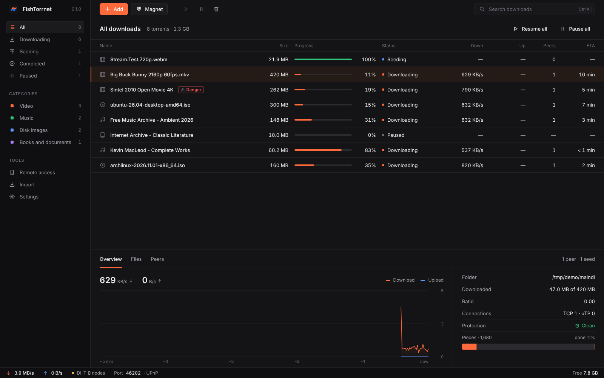
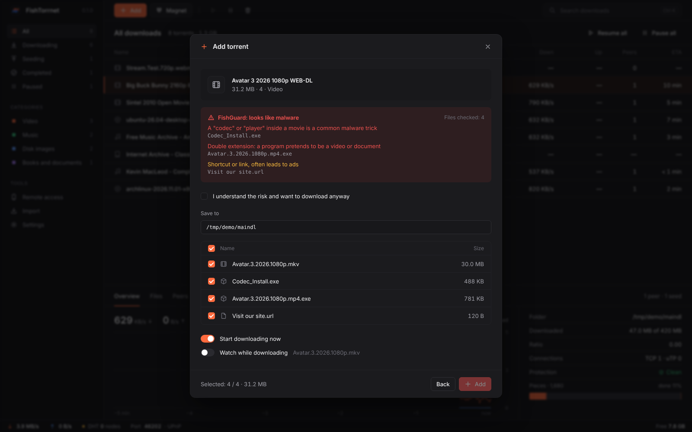
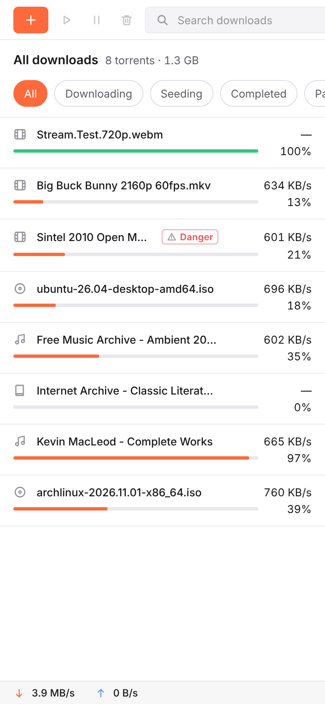

<p align="center">
  <picture>
    <source media="(prefers-color-scheme: dark)" srcset="../../assets/logo-dark.svg">
    
  </picture>
</p>

<h1 align="center">FishTorrnet</h1>

<p align="center">
  <b>速くて誠実な BitTorrent クライアント。</b><br>
  広告なし。テレメトリなし。オープンソース。
</p>

<p align="center">
  <a href="https://github.com/myfreeze-art/FishTorrnet/releases/latest"></a>
  <a href="https://github.com/myfreeze-art/FishTorrnet/releases"></a>
  <a href="https://github.com/myfreeze-art/FishTorrnet/actions/workflows/ci.yml"></a>
  <a href="../../LICENSE"></a>
  
  
</p>

<p align="center">
  <a href="../../README.md">English</a> ·
  <a href="README.ru.md">Русский</a> ·
  <a href="README.uk.md">Українська</a> ·
  <a href="README.de.md">Deutsch</a> ·
  <a href="README.fr.md">Français</a> ·
  <a href="README.es.md">Español</a> ·
  <a href="README.pt-BR.md">Português</a> ·
  <a href="README.zh-CN.md">简体中文</a> ·
  <b>日本語</b> ·
  <a href="README.tr.md">Türkçe</a>
</p>

<p align="center">
  <a href="#ダウンロード">ダウンロード</a> ·
  <a href="#機能">機能</a> ·
  <a href="#ソースからビルド">ビルド</a> ·
  <a href="../../CONTRIBUTING.md">コントリビュート</a>
</p>

<p align="center">
  <picture>
    <source media="(prefers-color-scheme: light)" srcset="../screenshots/main-light.png">
    
  </picture>
</p>

## 機能

- **ダウンロードしながら再生。** 必要なピースから先に取得するので、動画や音楽は内蔵プレーヤーですぐに再生が始まります。VLC でストリームを開くこともできます。
- **FishGuard。** すべてのトレントを開始前にチェックします。`video.mp4.exe` のような二重拡張子、ファイル名を反転させる隠し文字、映画トレント内のプログラムや偽コーデック、広告ショートカット、パスワードファイルを検出します。危険なトレントは、リスクを確認するまで追加できません。
- **スマホから操作。** リモートアクセスをオンにして QR コードを読み取るだけ。画面は小さな端末に合わせて調整されます。
- **ワンクリックで乗り換え。** qBittorrent と uTorrent からトレントをフォルダーごとインポート。ダウンロード済みのファイルは検証され、シードを続けます。
- **標準的な BitTorrent。** マグネットリンク、.torrent ファイル、トラッカー、DHT、PEX、uTP、UPnP、ローカルピア探索に対応。qBittorrent や Transmission など他のクライアントと同じスウォームに参加します。
- **どこでも美しく。** ロゴもそろえたダーク／ライトテーマ、システムに合わせて切り替わる 10 言語、再起動不要の速度制限。

| | FishTorrnet | qBittorrent | Transmission |
| --- | :---: | :---: | :---: |
| 広告なし、オープンソース | あり | あり | あり |
| ダウンロード中に内蔵プレーヤーで再生 | あり | シーケンシャルダウンロードのみ | なし |
| ダウンロード前のマルウェアチェック | あり | なし | なし |
| QR コードでスマホから操作 | あり | Web UI | Web UI |
| 他のクライアントからのインポート | あり | なし | なし |
| 画面なしサーバーと Docker イメージ | あり | あり | あり |

<table>
  <tr>
    <td width="62%"></td>
    <td width="38%"></td>
  </tr>
  <tr>
    <td align="center"><code>.mp4.exe</code> を含む偽の映画を FishGuard が止めます</td>
    <td align="center">同じダウンロードをスマホで</td>
  </tr>
</table>

## ダウンロード

最新版は [Releases](https://github.com/myfreeze-art/FishTorrnet/releases/latest) ページから入手できます。

| システム | インストール方法 |
| --- | --- |
| Windows 10 / 11 | `FishTorrnet_x64-setup.exe` または `winget install myfreeze-art.FishTorrnet` |
| macOS 11 以降 | `FishTorrnet_universal.dmg`, Intel と Apple Silicon に対応 |
| Ubuntu, Debian, Mint | `.deb` パッケージ |
| Fedora, openSUSE | `.rpm` パッケージ |
| Arch Linux | `yay -S fishtorrnet-bin` |
| その他の Linux | `.AppImage` |
| サーバーや NAS | `docker run -p 8787:8787 -v ./downloads:/downloads ghcr.io/myfreeze-art/fishtorrnet` |

FishTorrnet は無料のため、インストーラーは有料の証明書で署名されておらず、初回に一度だけ警告が出ます。Windows では **詳細情報** をクリックしてから **実行** を選びます。macOS では **システム設定 → プライバシーとセキュリティ** を開き、**このまま開く** をクリックします。各リリースには `SHA256SUMS.txt` が含まれ、ファイルが改ざんされていないか確認できます。

## 言語

アプリは English、Русский、Українська、Deutsch、Français、Español、Português、简体中文、日本語、Türkçe に対応しています。システムの言語が自動で選ばれ、**設定 → 表示** で変更できます。あなたの言語を追加したい場合は [docs/TRANSLATING.md](../TRANSLATING.md) をご覧ください。

## ソースからビルド

Rust 1.85 以降と Node.js 20 以降が必要です。Linux では先に WebKitGTK の開発パッケージをインストールしてください（[docs/DEVELOPMENT.md](../DEVELOPMENT.md) を参照）。

```sh
git clone https://github.com/myfreeze-art/FishTorrnet.git
cd FishTorrnet
npm ci && npm ci --prefix ui
npm run app:build
```

インストーラーは `target/release/bundle` に作られます。画面なしのサーバーは `cargo build --release -p fishtorrnet-server` でビルドできます。

## ドキュメント

- [開発、プロジェクト構成、HTTP API](../DEVELOPMENT.md)
- [リリースとストアでの公開](../../packaging/README.md)
- [アプリの翻訳](../TRANSLATING.md)
- [コントリビュート](../../CONTRIBUTING.md) · [セキュリティ](../../SECURITY.md)

## ライセンス

FishTorrnet は [GNU GPL v3 以降](../../LICENSE) のもとで公開されている自由ソフトウェアです。BitTorrent コアは [librqbit](https://github.com/ikatson/rqbit)（Apache-2.0）です。
