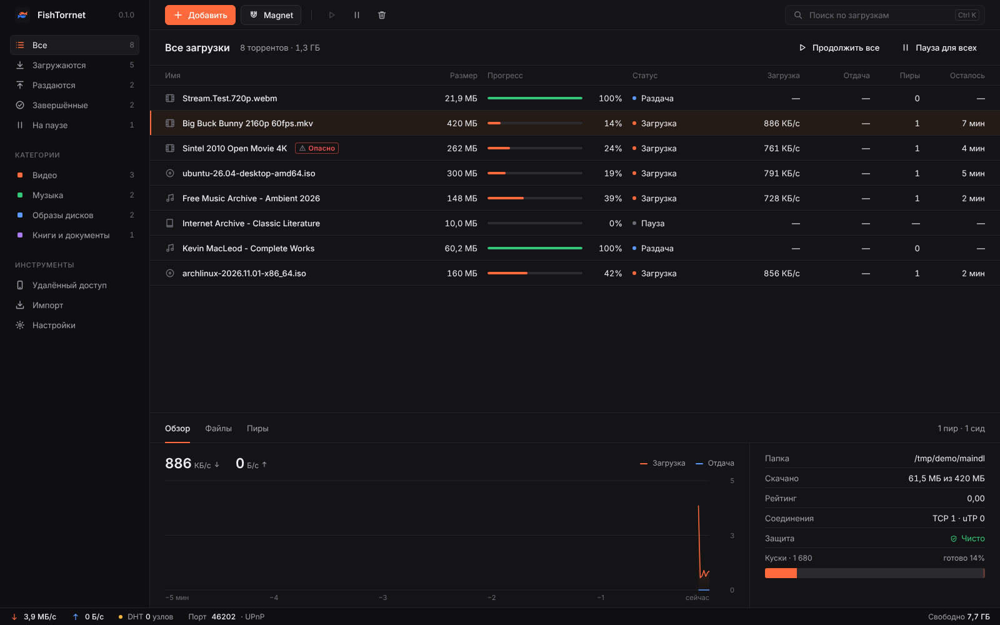
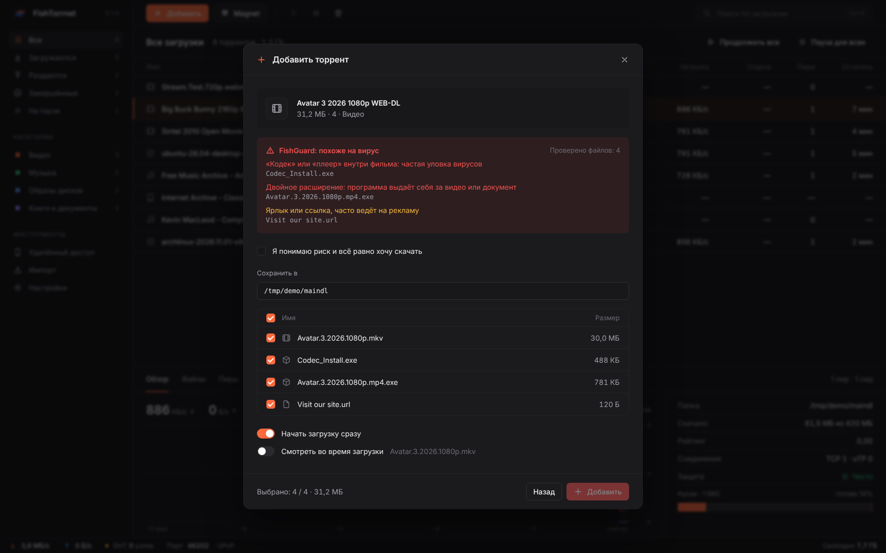
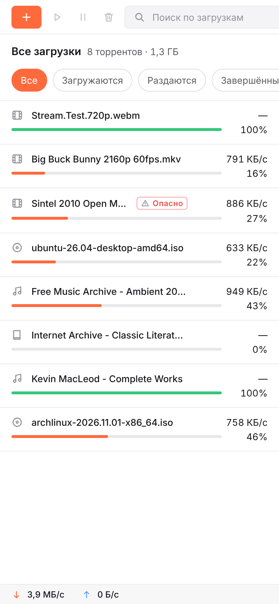

<p align="center">
  <picture>
    <source media="(prefers-color-scheme: dark)" srcset="../../assets/logo-dark.svg">
    
  </picture>
</p>

<h1 align="center">FishTorrnet</h1>

<p align="center">
  <b>Быстрый и честный BitTorrent-клиент.</b><br>
  Без рекламы. Без телеметрии. С открытым кодом.
</p>

<p align="center">
  <a href="https://github.com/myfreeze-art/FishTorrnet/releases/latest"></a>
  <a href="https://github.com/myfreeze-art/FishTorrnet/releases"></a>
  <a href="https://github.com/myfreeze-art/FishTorrnet/actions/workflows/ci.yml"></a>
  <a href="../../LICENSE"></a>
  
  
</p>

<p align="center">
  <a href="../../README.md">English</a> ·
  <b>Русский</b> ·
  <a href="README.uk.md">Українська</a> ·
  <a href="README.de.md">Deutsch</a> ·
  <a href="README.fr.md">Français</a> ·
  <a href="README.es.md">Español</a> ·
  <a href="README.pt-BR.md">Português</a> ·
  <a href="README.zh-CN.md">简体中文</a> ·
  <a href="README.ja.md">日本語</a> ·
  <a href="README.tr.md">Türkçe</a>
</p>

<p align="center">
  <a href="#скачать">Скачать</a> ·
  <a href="#возможности">Возможности</a> ·
  <a href="#сборка-из-исходников">Сборка</a> ·
  <a href="../../CONTRIBUTING.md">Участие</a>
</p>

<p align="center">
  <picture>
    <source media="(prefers-color-scheme: light)" srcset="../screenshots/ru/main-light.png">
    
  </picture>
</p>

## Возможности

- **Смотрите во время загрузки.** Видео и музыка сразу открываются во встроенном плеере: нужные куски скачиваются первыми. Поток можно открыть и в VLC.
- **FishGuard.** Каждая раздача проверяется до начала загрузки. FishTorrnet ловит двойные расширения вроде `video.mp4.exe`, скрытые символы, которые переворачивают имя файла, программы и поддельные кодеки в фильмах, рекламные ярлыки и файлы с паролями. Опасную раздачу нельзя добавить, пока вы не подтвердите риск.
- **Управление с телефона.** Включите удалённый доступ и отсканируйте QR-код. Интерфейс подстраивается под маленький экран.
- **Переезд в один клик.** Импорт раздач из qBittorrent и uTorrent вместе с папками. Скачанные файлы проверяются и продолжают раздаваться.
- **Обычный BitTorrent.** Magnet-ссылки, .torrent-файлы, трекеры, DHT, PEX, uTP, UPnP и поиск пиров в локальной сети. FishTorrnet работает в одной сети с qBittorrent, Transmission и любыми другими клиентами.
- **Красиво везде.** Тёмная и светлая тема со своим логотипом, 10 языков интерфейса с автоопределением, ограничение скорости без перезапуска.

| | FishTorrnet | qBittorrent | Transmission |
| --- | :---: | :---: | :---: |
| Без рекламы, открытый код | Да | Да | Да |
| Встроенный плеер во время загрузки | Да | Только последовательная загрузка | Нет |
| Проверка на вирусы до загрузки | Да | Нет | Нет |
| Управление с телефона по QR-коду | Да | Web UI | Web UI |
| Импорт из других клиентов | Да | Нет | Нет |
| Сервер без окна и Docker-образ | Да | Да | Да |

<table>
  <tr>
    <td width="62%"></td>
    <td width="38%"></td>
  </tr>
  <tr>
    <td align="center">FishGuard останавливает фальшивый фильм с <code>.mp4.exe</code> внутри</td>
    <td align="center">Те же загрузки на телефоне</td>
  </tr>
</table>

## Скачать

Последняя версия на странице [Releases](https://github.com/myfreeze-art/FishTorrnet/releases/latest).

| Система | Как установить |
| --- | --- |
| Windows 10 и 11 | `FishTorrnet_x64-setup.exe` или `winget install myfreeze-art.FishTorrnet` |
| macOS 11 и новее | `FishTorrnet_universal.dmg`, для Intel и Apple Silicon |
| Ubuntu, Debian, Mint | пакет `.deb` |
| Fedora, openSUSE | пакет `.rpm` |
| Arch Linux | `yay -S fishtorrnet-bin` |
| Любой Linux | `.AppImage` |
| Сервер или NAS | `docker run -p 8787:8787 -v ./downloads:/downloads ghcr.io/myfreeze-art/fishtorrnet` |

FishTorrnet бесплатный, поэтому установщики не подписаны платным сертификатом, и система один раз предупредит. В Windows нажмите **Подробнее**, затем **Выполнить в любом случае**. В macOS откройте **Системные настройки → Конфиденциальность и безопасность** и нажмите **Всё равно открыть**. В каждом выпуске есть `SHA256SUMS.txt`: по нему можно проверить, что файл не подменён.

## Языки

Программа говорит на English, Русский, Українська, Deutsch, Français, Español, Português, 简体中文, 日本語 и Türkçe. Язык выбирается по системе, сменить его можно в **Настройки → Интерфейс**. Хотите добавить свой? Смотрите [docs/TRANSLATING.md](../TRANSLATING.md).

## Сборка из исходников

Нужны Rust 1.85+ и Node.js 20+. На Linux сначала установите пакеты разработки WebKitGTK (см. [docs/DEVELOPMENT.md](../DEVELOPMENT.md)).

```sh
git clone https://github.com/myfreeze-art/FishTorrnet.git
cd FishTorrnet
npm ci && npm ci --prefix ui
npm run app:build
```

Установщики появятся в `target/release/bundle`. Для сервера без окна используйте `cargo build --release -p fishtorrnet-server`.

## Документация

- [Разработка, устройство проекта и HTTP API](../DEVELOPMENT.md)
- [Выпуск версий и публикация в магазинах](../../packaging/README.md)
- [Перевод программы](../TRANSLATING.md)
- [Как помочь проекту](../../CONTRIBUTING.md) · [Безопасность](../../SECURITY.md)

## Лицензия

FishTorrnet — свободная программа под лицензией [GNU GPL v3 или новее](../../LICENSE). Ядро BitTorrent — [librqbit](https://github.com/ikatson/rqbit) (Apache-2.0).
